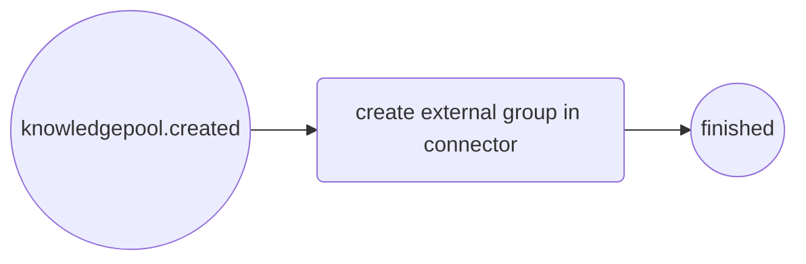
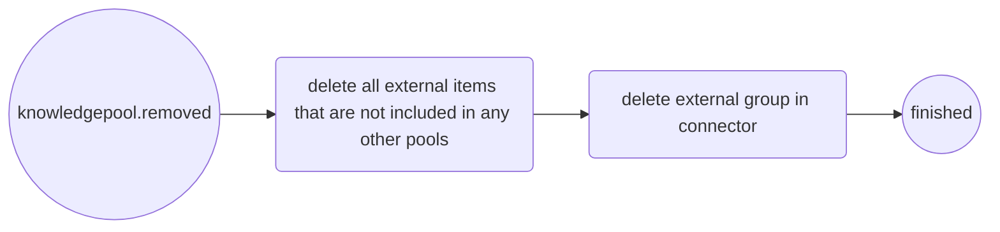
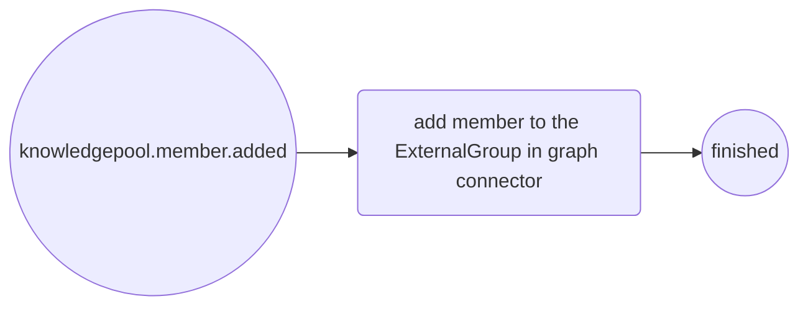
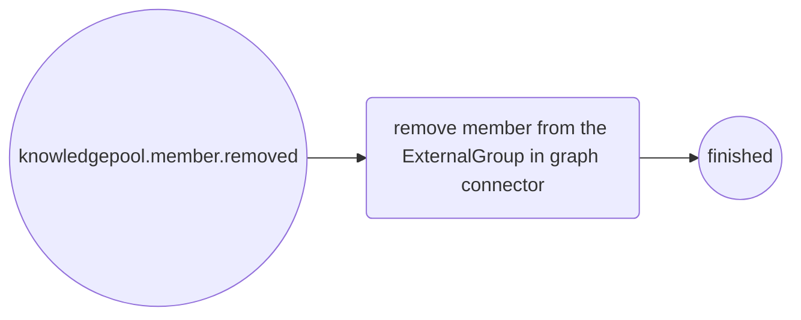
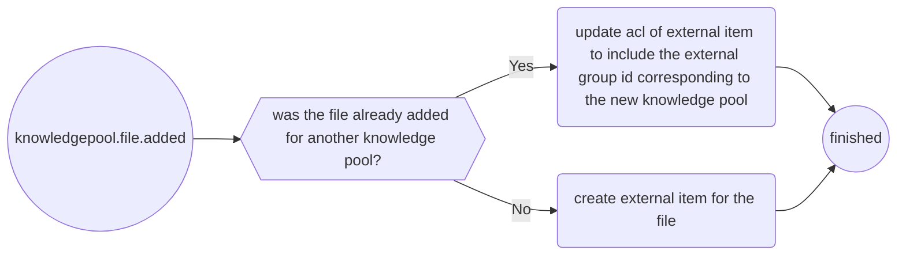
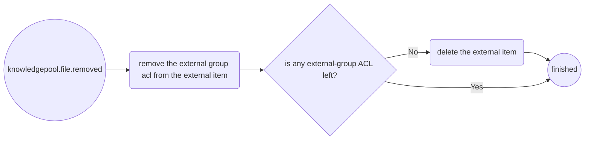
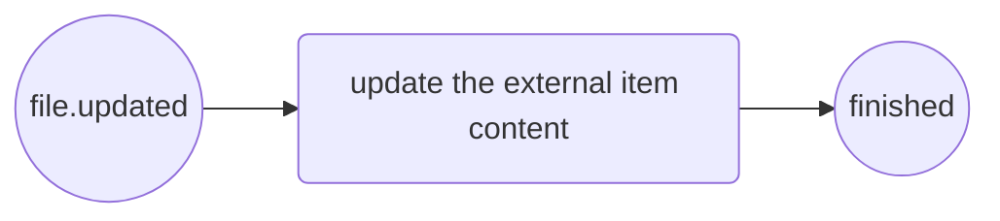

# Webhook Events

The following webhook events reflect roXtra AI Hub with the latest roXtra version. Events related to documents are only sent if the document is released. For older versions of roXtra, the behavior may be different.

Handle each event atomically: either complete all related changes or leave the system in its previous consistent state. Acknowledge success only after every processing step completes. roXtra AI Hub automatically retries the event when the webhook call returns a non-success response. On failure, roll back or compensate for partial changes and ensure retries are idempotent.

If your connector does not follow this approach, it must handle partial failures, retries, and restoring a consistent state on its own.















Example payloads

- knowledgepool.created

  ```json
  {
    "type": "knowledgepool.created",
    "knowledgePoolId": "<knowledgePoolId>"
  }
  ```

- knowledgepool.removed

  ```json
  {
    "type": "knowledgepool.removed",
    "knowledgePoolId": "<knowledgePoolId>"
  }
  ```

- knowledgepool.member.added

  ```json
  {
    "type": "knowledgepool.member.added",
    "knowledgePoolId": "<knowledgePoolId>",
    "roxtraGroupGid": "<roxtraGroupGuid>",
    "externalGroupId": "<externalGroupId>"
  }
  ```

- knowledgepool.member.removed

  ```json
  {
    "type": "knowledgepool.member.removed",
    "knowledgePoolId": "<knowledgePoolId>",
    "roxtraGroupGid": "<roxtraGroupGuid>",
    "externalGroupId": "<externalGroupId>"
  }
  ```

- knowledgepool.file.added
  - for roXtra version `9.138.0` and later, `downloadUrls` is included in the payload. The `downloadUrls` object contains a unique download URL for each file format the document is available in.
    `downloadUrl` is still included for backward compatibility. `supportedForKnowledgePools` now represents whether the file is available as PDF for backward compatibility.

  ```json
  {
    "type": "knowledgepool.file.added",
    "fileId": "<roxFileId>",
    "knowledgePoolId": "<knowledgePoolId>",
    "downloadUrl": "<downloadUrlForPdf>",
    "downloadUrls": {
      "pdf": "<downloadUrlForPdf>",
      "docx": "<downloadUrlForOriginalFile>"
    },
    "title": "<title>",
    "documentHash": "<documentHash>",
    "supportedForKnowledgePools": true
  }
  ```

  <details>
  <summary>Older payload versions</summary>

  - for roXtra version `9.137.0`, `documentHash` is included in the payload

  ```json
  {
    "type": "knowledgepool.file.added",
    "fileId": "<roxFileId>",
    "knowledgePoolId": "<knowledgePoolId>",
    "downloadUrl": "<downloadUrlForPdf>",
    "title": "<title>",
    "documentHash": "<documentHash>",
    "supportedForKnowledgePools": true
  }
  ```

  - for roXtra version lower than `9.137.0`

  ```json
  {
    "type": "knowledgepool.file.added",
    "fileId": "<roxFileId>",
    "knowledgePoolId": "<knowledgePoolId>",
    "downloadUrl": "<downloadUrlForPdf>",
    "title": "<title>",
    "supportedForKnowledgePools": true
  }
  ```

  </details>

- file.updated
  - for roXtra version `9.138.0` and later, `downloadUrls` is included in the payload. The `downloadUrls` object contains a unique download URL for each file format the document is available in.
    `downloadUrl` is still included for backward compatibility. `supportedForKnowledgePools` now represents whether the file is available as PDF for backward compatibility.

  ```json
  {
    "type": "file.updated",
    "fileId": "<roxFileId>",
    "knowledgePoolId": "<knowledgePoolId>",
    "downloadUrl": "<downloadUrlForPdf>",
    "downloadUrls": {
      "pdf": "<downloadUrlForPdf>",
      "docx": "<downloadUrlForOriginalFile>"
    },
    "title": "<title>",
    "documentHash": "<documentHash>",
    "supportedForKnowledgePools": true
  }
  ```

  <details>
  <summary>Older payload versions</summary>

  - for roXtra version `9.137.0`, `documentHash` is included in the payload

  ```json
  {
    "type": "file.updated",
    "fileId": "<roxFileId>",
    "knowledgePoolId": "<knowledgePoolId>",
    "downloadUrl": "<downloadUrlForPdf>",
    "title": "<title>",
    "documentHash": "<documentHash>",
    "supportedForKnowledgePools": true
  }
  ```

  - for roXtra version lower than `9.137.0`

  ```json
  {
    "type": "file.updated",
    "fileId": "<roxFileId>",
    "knowledgePoolId": "<knowledgePoolId>",
    "downloadUrl": "<downloadUrlForPdf>",
    "title": "<title>",
    "supportedForKnowledgePools": true
  }
  ```

  </details>

- knowledgepool.file.removed

  ```json
  {
    "type": "knowledgepool.file.removed",
    "fileId": "<roxFileId>",
    "knowledgePoolId": "<knowledgePoolId>"
  }
  ```
